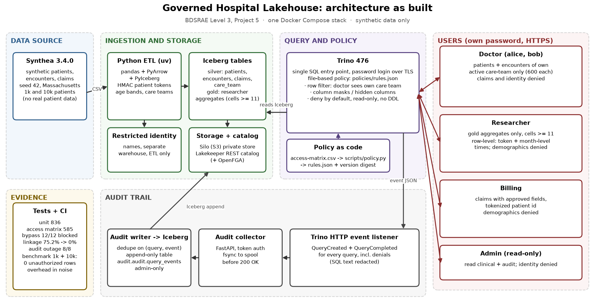

# Governed Hospital Lakehouse with Fine-Grained Access Control

BDSRAE Level 3, Project 5 · Adarsha E (PES1UG24AM334), Abdul Mateen Shaikh (PES1UG24AM332)

One shared set of synthetic hospital tables, queried through a single SQL engine
that shows each person only what their role allows. Doctors see only their own
care-team patients, researchers see only aggregate counts (no cell under 11
patients), billing sees claims with tokenized patient IDs, and every query,
allowed or denied, lands in an append-only audit table.



## Results at a glance

All numbers come from committed evidence; nothing below is estimated.

| What we measured | Result | Evidence |
|---|---|---|
| Access matrix, doctor filters, masks, denials (live Trino) | 585/585 checks pass | [CI run 41205107037](results/sanitized/ci-41205107037/) |
| Bypass attempts (12 attack types) | **12/12 blocked** (first run: 9 blocked, 2 leaked, 1 inconclusive) | [bypass report](docs/bypass-report.md) |
| Re-identification by linkage, researcher view | 9.3% → **0%**; with rare diagnoses 75.2% → **0%** | [bypass report](docs/bypass-report.md), [#46](docs/issue-46.md) |
| Count differencing on one patient | possible → **not possible** | same |
| Audit during collector outage | 4 queries, 8/8 events, 0 missing, 0 duplicates | [audit coverage](results/sanitized/ci-41205107037/audit-coverage.json) |
| Policy overhead, 1k and 10k patients | 12/12 identical results, 0 unauthorized rows; warm median −2.1% / +1.2% (within noise) | [benchmark run](results/raw/bench-20261030T174823Z/) |
| Unit tests | 836 pass | CI |

Figures: [`results/figures/`](results/figures/), built by
[`notebooks/results.ipynb`](notebooks/results.ipynb). Audit sample:
[`results/sanitized/audit-sample/`](results/sanitized/audit-sample/).

## Who sees what

| Role | Patients | Encounters | Claims | Research aggregates | Identity (names) | Audit |
|---|---|---|---|---|---|---|
| Doctor (`doctor_alice`, `doctor_bob`) | own active care team only | own care team only | denied | denied | denied | denied |
| Researcher | token only | month-level times, no reason codes | denied | `hospital.gold`, cells ≥ 11 | denied | denied |
| Billing | denied | denied | approved fields, tokenized patient | denied | denied | denied |
| Admin (read-only) | read | read | read | read | denied | read (SQL text hidden) |

The full decision per column is in [`policies/access-matrix.csv`](policies/access-matrix.csv);
[`scripts/policy.py`](scripts/policy.py) compiles it to the deployed
[`policies/rules.json`](policies/rules.json) and records a version digest.

## Architecture

- **Data:** [Synthea 3.4.0](docs/data-card.md), seed 42, 1,000 (and 10,000 for the
  benchmark) synthetic Massachusetts patients. No real patient data.
- **ETL** ([`ingest/`](ingest/)): Python, pandas, PyArrow, PyIceberg. Patient IDs
  become HMAC tokens, ages become bands, care-team assignments are generated
  with a fixed seed, names go to a separate restricted identity warehouse, and
  every load rebuilds the researcher aggregate releases.
- **Storage:** Apache Iceberg tables on Silo (S3-compatible, private bucket),
  registered in a Lakekeeper REST catalog (Postgres, Keycloak, OpenFGA).
- **Query and policy:** Trino 476 is the only way in for people. Password login
  over HTTPS, file-based access control with row filters and column masks,
  deny by default, read-only, no DDL or grants.
- **Audit** ([`audit/`](audit/)): Trino's HTTP event listener → FastAPI collector
  (fsync to a spool before acknowledging) → batch writer (de-duplicates on query
  and event type) → append-only Iceberg table `audit.audit.query_events`, readable
  only by admin. SQL text and literal values are never stored.
- **Dashboard** ([`dashboard/`](dashboard/)): a Streamlit demo client. It holds no
  privileges; Trino is the boundary.

Design decisions: [architecture and ADRs](docs/architecture.md),
[threat model](docs/threat-model.md), [data card](docs/data-card.md).

## Run it locally

Needs Docker with Compose v2 (on Windows, inside WSL2), `uv`, Java 17+, OpenSSL,
Bash and about 8 GB of free RAM. Tested on Ubuntu (WSL2).

**Quick start:** `./start.sh` runs every step below and opens the dashboard at
<http://localhost:8501>. It is safe to re-run; existing secrets and data are kept.
`./stop.sh` stops the services without deleting anything. Options:
`--patients N`, `--seed S`, `--no-dashboard`.

Manual steps:

```sh
# 1. Install
uv sync --locked --group dev

# 2. Secrets, users and TLS (written to data/secrets/, git-ignored)
./scripts/init_secrets.sh
export TRINO_UID=$(id -u) TRINO_GID=$(id -g) AUDIT_UID=$(id -u) AUDIT_GID=$(id -g)
alias dc='docker compose --env-file data/secrets/runtime.env'

# 3. Storage
dc up -d --wait storage
dc run --rm storage-init

# 4. Catalog
dc build catalog-init
dc up -d --wait catalog
dc run --rm --no-deps catalog-init

# 5. Trino and the audit pipeline
dc up -d --wait trino audit-writer

# 6. Data: generate, then load silver, identity and gold
./scripts/generate_synthea.sh --patients 1000 --seed 42
./scripts/ingest.sh
```

Each user's password is in `data/secrets/runtime.env`
(`TRINO_PASSWORD_DOCTOR_ALICE`, `..._RESEARCHER`, `..._BILLING`, `..._ADMIN`).

```sh
dc exec trino trino --server https://localhost:8443 --user doctor_alice \
  --password --truststore-path /etc/trino/auth/ca.crt
```

Try:

- `doctor_alice`: `SELECT count(*) FROM hospital.silver.patients;` → 600, her care team only.
- `doctor_alice`: `SELECT claim_id FROM hospital.silver.claims LIMIT 5;` → Access Denied.
- `researcher`: `SELECT * FROM hospital.gold.researcher_demographics ORDER BY patient_count LIMIT 5;` → smallest count is 11 or more.
- anyone: `SELECT * FROM identity.identity.patient_identity;` → denied.
- `admin`, a few seconds later: `SELECT event_type, authenticated_user, status FROM audit.audit.query_events;` → every query above, denials included.

Dashboard:

```sh
export TRINO_HOST=localhost TRINO_PORT=8443 TRINO_CA_BUNDLE=data/secrets/ca.crt
uv run --no-sync --with streamlit streamlit run dashboard/app.py
```

The Trino CLI may warn that JLine and `.trino_history` cannot be written inside
the read-only container; this is harmless. Per-service details:
[storage](docker/storage/README.md), [catalog](docker/catalog/README.md),
[Trino](docker/trino/README.md), [ingestion](ingest/README.md),
[audit writer](audit/writer.md).

## Reproduce the evidence

```sh
uv run --locked --group dev pytest tests/unit                                   # unit
RUN_ACCESS_INTEGRATION=1 uv run --locked --group dev pytest tests/access -v     # access matrix
ACCESS_TEST_SOURCE="$PWD/data/raw/synthea/1000-seed42" \
  RUN_BYPASS_INTEGRATION=1 uv run --locked --group dev pytest tests/bypass -v   # bypass + privacy + audit outage
uv run --locked python bench/run.py --help                                      # policy-overhead benchmark
uv run --locked python scripts/export_audit_sample.py --limit 40                # audit sample (stack running)
```

Integration suites start their own isolated Compose project with fresh random
credentials and leave your stack alone. CI ([`.github/workflows/ci.yml`](.github/workflows/ci.yml))
runs all of them on every push; the benchmark has its own workflow.
Raw per-run evidence stays in git-ignored `results/raw/`; only aggregate
summaries are committed.

## Limits, stated plainly

- HMAC tokens are pseudonyms, not anonymity: whoever holds the key can re-link them.
- Small-cell suppression (≥ 11) is a disclosure rule, not a formal anonymity or
  differential-privacy guarantee, and results are on synthetic data.
- The audit table is append-only by grant, not tamper-evident. Query logs show
  what was asked, not exactly which records a person read.
- Admin and service credentials are trusted; host or key compromise is out of scope.
- Internal service traffic is HTTP on a private Docker network; TLS covers
  client-to-Trino.
- 100,000-patient scale was not run.

## Repository map

| Path | Contents |
|---|---|
| `docker/`, `compose.yaml` | service configuration |
| `ingest/` | ETL, tokenization, column classification, gold releases |
| `policies/` | access contract and deployed Trino rules |
| `audit/` | event normalizer, collector, writer |
| `sql/` | schema DDL |
| `tests/` | unit, integration, access and bypass suites |
| `bench/` | benchmark plan, workload and runner |
| `notebooks/`, `results/` | results notebook, figures, committed evidence |
| `dashboard/` | Streamlit demo client |
| `docs/` | data card, threat model, bypass report, architecture, issue notes |
| `scripts/` | data generation, secrets, ingestion, policy, summaries |
