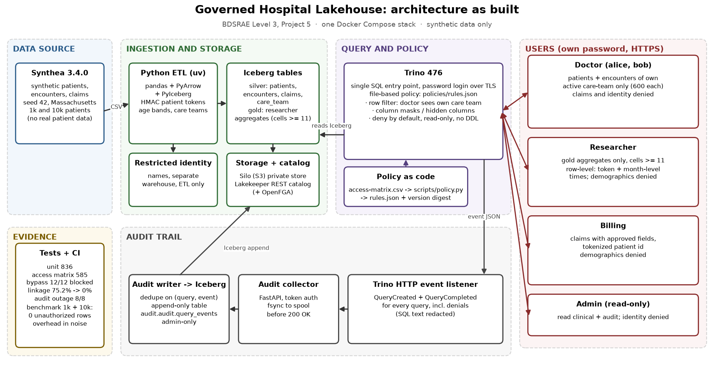
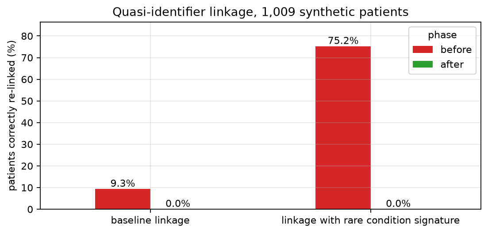

**Repository:** <https://github.com/Adarsh-031/Governed-Lakehouse-With-Fine-Grained-Access-Control>.
Every number in this report comes from a committed evidence file named in the text;
nothing is estimated.

# 1. Problem

A hospital wants one shared analytics store instead of a separate copy per team, but
different people may see different things. A doctor should see full clinical detail for
their own patients and nothing about anyone else's. A researcher needs population
statistics, not people. Billing needs claims and costs, not diagnoses or demographics.
Every access must be recorded, and the design must be tested against people actively
trying to get around it.

The goal was to build that store on open lakehouse components, enforce row filters and
column masks through a policy engine, log every query, attack it with a bypass suite,
and measure both the security outcome and the systems cost. All data is synthetic
(Synthea 3.4.0, seed 42, Massachusetts).

# 2. Architecture

{width=100%}

**Data and ETL.** Synthea generates patients, encounters and claims. A Python ETL
(pandas, PyArrow, PyIceberg) validates them, replaces each source patient ID with a
versioned HMAC-SHA-256 token, derives age bands from a fixed reference date, generates
care-team assignments with a fixed seed (600 patients per doctor, 200 shared), writes
names into a separate restricted identity warehouse, and builds three researcher
aggregate tables. The 1,000-patient load produces 1,000 patients, 48,976 encounters,
203,698 charge-level claim lines and 1,200 care-team rows.

**Storage and catalog.** Tables are Apache Iceberg on Silo (an S3-compatible MinIO
fork) with no anonymous access and per-service, prefix-scoped keys. Lakekeeper is the
Iceberg REST catalog, backed by Postgres, Keycloak (service OIDC) and OpenFGA.

**Query and policy.** Trino 476 is the only entry point for people. Users log in with
their own password over HTTPS; their group comes from a server-side file, never from
the client. Authorization is Trino's file-based access control. The human-readable
contract (`policies/access-matrix.csv`, one decision per group, table and column) is
compiled by `scripts/policy.py` into `policies/rules.json` with a version and SHA-256
digest, so the deployed policy is reviewable code.

**Audit.** Trino's HTTP event listener posts a `QueryCreated` and a `QueryCompleted`
event for every query, including denials. A FastAPI collector authenticates the post and
fsyncs it to a spool before replying, so Trino retries anything not durably received.
A batch writer de-duplicates on (query ID, event type) and appends to an Iceberg table
`audit.audit.query_events` that only admin can read. SQL text and literals are redacted
before storage; even admin cannot select the redacted text column.

# 3. Access policy

| Role | Rows | Columns and tables |
|---|---|---|
| Doctor | patients and encounters only where the doctor has an *active* care-team assignment | full clinical fields; claims, identity and audit denied |
| Researcher | all, but only through aggregates | `hospital.gold` releases: distinct-patient counts by age band/sex/race, ZIP prefix, and reason code, cells under 11 dropped; row level only the token and month-truncated encounter times |
| Billing | all claims | procedure code, cost, payer, tokenized patient; description hidden; patients and encounters denied |
| Admin | all, read-only | clinical and audit tables; identity denied; no DDL, DML, grants or session changes |

The doctor row filter joins each query to `care_team` on the authenticated user and the
validity dates, evaluated by an internal identity that no person can log in as. Every
interactive role is read-only, and anything not listed is denied.

# 4. Threat model

A STRIDE model (`docs/threat-model.md`) covers eight assets and ten actors. In scope:
authenticated users exceeding their role, unauthenticated clients probing storage and
catalog, and analysts with auxiliary data attempting inference. Out of scope: host or
Docker root, stolen service credentials and malicious administrators, which can bypass
any application-layer control. Each of the twelve bypass cases maps to a STRIDE threat:
impersonation (S-01), direct storage and catalog reads (I-01), another doctor's patients
through joins, CTEs or snapshots (I-02, I-03), metadata enumeration (I-04), aggregate
inference (I-05), quasi-identifier linkage (I-06), privilege escalation (E-01) and lost
audit events (R-01).

# 5. Method

**Access tests.** 585 live checks run the full access matrix against a disposable stack.
Expected doctor rows come from a care-team oracle saved *before* data is written, and
mask outputs are recomputed independently in Python, so expectations never come from
the system under test.

**Bypass suite.** Twelve cases (`tests/bypass/cases.csv`), one handler each; collection
fails if the inventory and handlers differ. Every denial must be paired with a positive
control (the same object read successfully with valid credentials) and must fail with
`PERMISSION_DENIED`; any other error is *inconclusive*, never a pass. Privacy cases
measure k-anonymity, singleton share, exact-count differencing and linkage against
synthetic ground truth, assuming a strong attacker who knows a target's exact age band,
sex, ZIP prefix and rare diagnosis codes (codes held by at most 5% of patients).

**Audit outage.** The suite stops the collector, issues queries, restarts it, and
reconciles known Trino query IDs against the audit table.

**Benchmark.** Twelve role queries at 1,000 and 10,000 patients, each run as the
enforced role and as an admin baseline with the same filter and masks inlined by hand.
One cold run after a Trino restart and ten warm runs per query, on a 4-vCPU, 7.8 GiB CI
runner. Outputs are compared by row count and a `checksum(ROW(...))` fingerprint.

All of this runs in GitHub Actions on every push (`ci.yml`, `benchmark.yml`).

# 6. Results

**Correctness.** CI run 41205107037: 836 unit tests, 585 access checks and 12 bypass
tests passed (`results/sanitized/ci-41205107037/`).

**Bypass.** The first run on 29 October (11 patients) blocked 9 cases, leaked 2 and
left 1 inconclusive. All authorization-boundary cases held from the start; the leaks
were not policy failures but what a correctly authorized researcher could infer. The
final run on 1,009 patients blocked all 12.

| Researcher privacy (1,009 patients) | Before #46 | After #46 |
|---|---|---|
| Unique on age band + sex + ZIP | 94 (9.3%), k~min~ = 1 | no row-level quasi-identifiers |
| Linkage with exact auxiliary data | 9.3% correct, 100% precision | 0% |
| Linkage adding rare diagnoses | 75.2% correct | 0% |
| Exact-count differencing on one patient | presence reconstructed | not possible |
| Smallest published cell | 1 | 11 (84 + 18 + 18 cells) |

The fix (#46) removed row-level demographics and reason codes from the researcher role
and replaced them with distinct-patient aggregates in which any cell under 11 is
absent, not merely small (Figure 2). The trade-off is real: researchers can no longer explore
individual cohorts, and rare subgroups disappear.

{width=62%}

**Audit.** During the outage, 4 queries produced 8 of 8 expected events: 0 missing,
0 duplicate, 0 invalid. A local export (`results/sanitized/audit-sample/`) shows
denials recorded with `PERMISSION_DENIED`, which tables carried a row filter, and the
row count returned.

**Systems cost.** All 12 queries returned identical fingerprints with and without
enforcement at both scales, with 0 unauthorized rows. Warm median overhead was -2.1%
at 1,000 patients (range -23.3% to +31.7%) and +1.2% at 10,000 (range -11.1% to
+10.1%), with enforced warm medians of 71.5 to 329.5 ms at 10,000 patients. Cold single
runs were noisier (medians +9.4% and -4.5%). With ten repetitions on a shared runner,
policy overhead is not distinguishable from noise at these scales. Iceberg storage grew
roughly linearly: claims 5.6 MB at 1,000 patients and 57.2 MB (2.16 M rows) at 10,000.

# 7. Limitations and ethics

- **Synthetic data.** Results show the design behaves as intended on Synthea output;
  they are not a real-world re-identification rate, and Synthea is not a representative
  population sample.
- **No formal privacy guarantee.** Small-cell suppression is a disclosure rule, not
  k-anonymity over all attributes or differential privacy. Repeated releases over time
  could still be differenced; a privacy budget would be the next step.
- **Pseudonyms, not anonymity.** Anyone holding the HMAC key can re-link tokens; the key
  is kept outside Git and away from query users, but the ETL service is trusted.
- **Audit limits.** The table is append-only by permission, not tamper-evident, and a
  query log shows what was asked, not which records a person actually read.
- **Trusted insiders.** Admin and service credentials, and the Docker host, are trusted.
  Internal traffic is HTTP on a private network; TLS covers client to Trino only.
- **Scale.** 100,000 patients was not run on the CI runner's resources.

Ethically, the project avoided real patient data entirely, kept raw per-run evidence
(which contains tokens and query IDs) private and git-ignored, and committed only
aggregate summaries. The most useful lesson was that correct authorization is not the
same as privacy: every query in the two leaked cases was permitted, and only
measurement against ground truth exposed the risk.

# References

1. J. Walonoski et al., "Synthea: An approach, method, and software mechanism for
   generating synthetic patients and the synthetic electronic health care record,"
   *JAMIA* 25(3), 2018. Synthea v3.4.0, <https://github.com/synthetichealth/synthea>.
2. Trino 476 documentation: file-based access control and HTTP event listener,
   <https://trino.io/docs/476/>.
3. Apache Iceberg table specification, <https://iceberg.apache.org/spec/>.
4. Lakekeeper Iceberg REST catalog, <https://docs.lakekeeper.io/>.
5. L. Sweeney, "k-anonymity: a model for protecting privacy," *Int. J. Uncertainty,
   Fuzziness and Knowledge-Based Systems* 10(5), 2002.
6. A. Shostack, *Threat Modeling: Designing for Security* (STRIDE), Wiley, 2014.
7. C. Dwork and A. Roth, "The Algorithmic Foundations of Differential Privacy,"
   *Foundations and Trends in TCS* 9(3–4), 2014.
